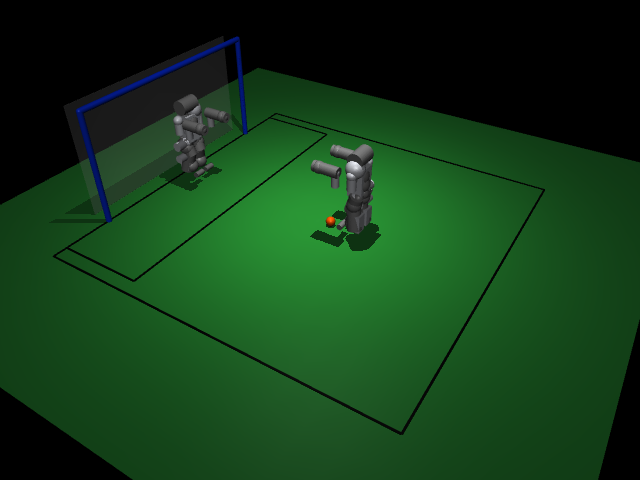

# PenaltyStack

Mini stack separado para penales NAO v6. Repositorio de origen: [SabanaHerons2026](https://github.com/juanulloa2050/SabanaHerons2026), revisión `2360ab1100ad28f70e190c893f6b095651ff0bbc`.

El controlador de tirador y portero comparte contratos de observación y comando con el simulador MuJoCo y el adaptador NAOqi. El simulador anterior SimRobot, el GameController y la comunicación de equipo no forman parte de este repositorio. El módulo completo `MotionControl` de B-Human se conserva como referencia de código en `baseline/bhuman/`; aún no se ejecuta aquí.



This product includes software developed by B-Human (http://www.b-human.de). Ver la licencia completa en `heritage/upstream/License.md`.

## Estado

- **Simulación:** dos NAO H25 V6 cargados desde URDF, balón físico y cancha de 2,4 × 2,4 m. El flujo actual desplaza las raíces de forma cinemática y usa un impulso de patada ideal. `JointSpaceEnv` expone 23 objetivos articulares por NAO para futuros ensayos de RL; no tiene política, recompensa ni marcha estable. Las mallas Webots no se pueden cargar y la apariencia usa primitivas aproximadas.
- **Motor original:** los 54 archivos de `Src/Modules/MotionControl` y su selección de dependencias/configuración (266 archivos en total) están preservados con hashes para comparación. No se han compilado, ejecutado ni conectado al adaptador NAOqi o a MuJoCo.
- **NAO:** cámara RGB, botón START, botón ABORT, control de cabeza y marcha acotada tienen adaptador onboard. Por defecto el proceso es de observación. El ejecutor físico de patada aún no está conectado; el adaptador rechaza `kick_enabled`.
- **Despliegue:** paquete Python para NAOqi 2.8 por Ethernet en `/home/nao/PenaltyStack`, aislado del servicio y los archivos de B-Human. No hay borrado remoto.

## Inicio rápido en PC

```powershell
python -m venv .venv
.\.venv\Scripts\python.exe -m pip install -r requirements-sim.txt
.\.venv\Scripts\python.exe -m unittest discover -s tests -v
.\.venv\Scripts\python.exe -m penalty.simulator --headless
```

Leer [arquitectura](docs/ARQUITECTURA.md), [operación y despliegue](docs/DESPLIEGUE.md) y [criterios para NAO real](docs/PREPARACION_NAO.md).
Ver también [modelo V6 y licencia](models/SOURCE.md) y [baseline motriz](baseline/README.md).
