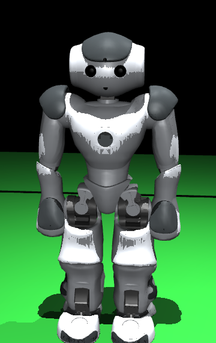

# PenaltyStack

Mini stack separado para penales NAO v6. Repositorio de origen: [SabanaHerons2026](https://github.com/juanulloa2050/SabanaHerons2026), revisión `2360ab1100ad28f70e190c893f6b095651ff0bbc`.

El controlador de tirador y portero comparte contratos de observación y comando con MuJoCo y el adaptador NAOqi. La simulación ejecuta el motor de movimiento original B-Human mediante un proceso C++ por NAO. El host de SimRobot, GameController y la comunicación de equipo quedan fuera del runtime.




This product includes software developed by B-Human (http://www.b-human.de). Ver los términos del [modelo 2025](models/bhuman/License.md) y del [baseline original](heritage/upstream/License.md).

## Estado

- **Simulación:** dos NAO V6 articulados con raíces libres, 50 mallas visuales distintas y 23 servos físicos por robot. El motor recibe IMU, articulaciones y cargas de pie actuales; las patadas mueven el balón por contacto físico. Hay panel de iniciar, pausa, paso, reinicio, repetición, ABORT y acciones manuales.
- **Motor original:** 559 archivos preservados con hashes, incluidos los 54 de `MotionControl`. Se compilan y ejecutan MotionEngine, WalkingEngine, KickEngine, KeyframeMotionEngine y sus proveedores. La integración usa orientación y percepción ideales; se documentan las adaptaciones en [runtime nativo](native/bhuman_motion/README.md).
- **NAO:** cámara RGB, botón START, botón ABORT, control de cabeza y marcha acotada tienen adaptador onboard. Por defecto el proceso es de observación. El ejecutor físico de patada aún no está conectado; el adaptador rechaza `kick_enabled`.
- **Visión Trionda:** balón naranja de 65 mm con patrón oscuro y cámaras `CameraBottom`/`CameraTop` en la cabeza de ambos NAO (offsets y apertura originales). `tools/vision_check.py` renderiza QVGA y compara `penalty/vision.py` contra el suelo verdadero; la FSM del ensayo sigue usando percepción ideal declarada.
- **Despliegue:** paquete Python para NAOqi 2.8 por Ethernet en `/home/nao/PenaltyStack`, aislado del servicio y los archivos de B-Human. No hay borrado remoto.

## Inicio rápido en Windows

```powershell
python -m venv .venv
.\.venv\Scripts\python.exe -m pip install -r requirements-sim.txt
.\.venv\Scripts\python.exe tools/build_motion_runtime.py  # requiere VS 2022 Build Tools + C++
.\.venv\Scripts\python.exe -m unittest discover -s tests -v
.\.venv\Scripts\python.exe -m penalty.simulator --headless
.\.venv\Scripts\python.exe tools/build_bhuman_model.py  # regenerar MJCF y mallas desde RSI3
```

## Inicio rápido en Linux

```bash
python3 -m venv .venv
.venv/bin/python -m pip install -r requirements-sim.txt
.venv/bin/python tools/build_motion_runtime.py   # GCC + CMake; adapta el baseline sin tocarlo
.venv/bin/python -m unittest discover -s tests -v
.venv/bin/python -m penalty.simulator --headless
.venv/bin/python tools/vision_check.py --trial   # visión Trionda de tirador y portero
```

El runtime nativo se compila con GCC/CMake y las adaptaciones de plataforma
quedan generadas en `native/bhuman_motion/build/generated` (los bytes del
baseline no se modifican). El visor y el panel necesitan un display y
`python3-tk` (`sudo apt install python3-tk`); sin ello, todo lo demás
(incluida la visión offscreen EGL/OSMesa) funciona headless.

Para abrir el visor y el panel:

```powershell
.\.venv\Scripts\python.exe -m penalty.simulator
```

```bash
.venv/bin/python -m penalty.simulator
```

La escena abre **pausada**. Pulsa **Iniciar**; ambos motores estabilizan la postura antes del reloj activo de 28 s. La ventana queda abierta al terminar. [Guía de controles, pruebas y limitaciones](docs/SIMULACION.md).

El ensayo inicial usa patada izquierda. La derecha se ejecuta y termina, pero todavía falla el contacto en esa colocación. En el ensayo automático el portero **no se lanza**: se sienta con el keyframe original `sitDownKeeper` y mantiene la guardia; los lanzamientos al suelo (`block`) quedan sólo en modo manual para comparación. Los bloqueos laterales manuales terminan en el suelo; la recuperación debe verificarse. **Esta integración no habilita todavía un penal completo en NAO real.**

Leer [arquitectura](docs/ARQUITECTURA.md), [operación y despliegue](docs/DESPLIEGUE.md) y [criterios para NAO real](docs/PREPARACION_NAO.md).
Ver también [modelo V6 y licencia](models/bhuman/README.md) y [baseline motriz](baseline/README.md).
