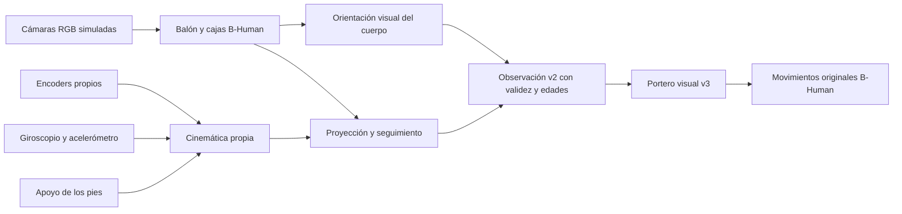

# Orientación del tirador desde cámaras y sensores simulados

2026-10-10. **Implementado en MuJoCo:** el portero estima el giro corporal
del rival desde imágenes RGB. Sus encoders, IMU y apoyos de los pies estiman
la transformación de la cámara y compensan el movimiento propio.
La pose verdadera del rival se consulta únicamente para evaluar el error.

Esto incorpora la información de orientación que faltaba. **Todavía no
demuestra una mejora adicional de atajadas frente al portero visual v2 ni
valida el estimador para imágenes de un NAO real.**

## Recorrido de los datos

| Dato | Entrada utilizada |
| --- | --- |
| Balón | RGB inferior, detector naranja y seguimiento entre capturas |
| Candidato a tirador | Cajas B-Human originales, suelo calibrado y cercanía al balón |
| Orientación corporal | Apariencia RGB del cuerpo; comparación circular con referencias visuales NAO |
| Articulaciones propias | Sensores MuJoCo `jointpos` leídos en `sensordata` |
| Actitud propia para visión | Giroscopio integrado cada 12 ms; corrección gradual de gravedad con acelerómetro |
| Apoyo y odometría | FSR propios derivados de contactos; cinemática de los pies y apoyo persistente |
| Transformación de cámara | Cinemática local con encoders y actitud estimada; sin poses globales de la cámara |



`sim_sensors.py` añade sensores a una variante nueva de la escena. Reconstruye
la geometría en datos cinemáticos separados: no altera raíces, articulaciones
ni velocidades del penal activo. Para percepción, yaw propio es relativo,
sin brújula absoluta ni consulta del cuaternión verdadero. La odometría
supone apoyo sin deslizamiento; puede acumular error. El motor de movimiento
conserva su perfil anterior `mujoco-truth-v2`, que incluye orientación propia
ideal; esta entrega cambia las entradas de visión/táctica, no ese controlador.

El seguidor nuevo encuadra cuerpo y balón juntos antes del tiro. Ante balón
entrante o cercano vuelve al seguimiento del balón. Ese cambio pertenece a
`keeper_sensor_camera_v2`; los experimentos anteriores conservan su mirada.

## Estimador visual y máscaras

`opponent_orientation.py` recibe exclusivamente RGB, caja del robot,
tiempos, asociación local, bearing proyectado y rotación propia.
No recibe objetivo del disparo, identidad/velocidad del rival, contactos del
balón ni pose verdadera del tirador.

Las 2294 referencias de `models/vision/nao_yaw_v1` representan giros cada
10°, tres distancias y 22 posturas articulares obtenidas con movimientos
originales B-Human. Se generan como fotografías estáticas en una escena de
referencia independiente. Sus etiquetas construyen la biblioteca; no se
usan como medidas durante un penal. El torso define la orientación y la
cabeza tiene menos peso para no confundir mirada con giro corporal.

La extracción usa colores/píxeles y mantiene la proporción del cuerpo.
No utiliza identificadores de segmentación, profundidad de MuJoCo ni un
modelo humano de esqueleto. La comparación circular maneja −180°/+180°.
Dos capturas independientes deben coincidir en el marco de odometría propio.

Se limpia `yaw_valid` ante falta de cuerpo/robot, recortes, pocos píxeles,
apariencia desconocida, coincidencias ambiguas, pérdida de sincronización,
edad mayor de 250 ms, repetición o cambio de asociación. La dispersión de
referencias se registra como incertidumbre con piso de 7.5°; **no es una
probabilidad calibrada para hardware**.

## Uso por el portero

`vision_keeper_v3` conserva la confirmación de dos capturas de balón entrante,
la estimación de llegada y el bloqueo único del v2. Guarda una pista de
postura anterior al disparo solamente con posición, yaw, edad y covarianza
válidos. Usa el predictor de lado anterior sin reentrenarlo y registra su
procedencia de poses ideales.

La pista sólo puede resolver una zona de 4 cm alrededor del límite de la
guardia central: exige al menos dos capturas recientes, incertidumbre angular
≤15°, probabilidad del predictor ≥0.90 y acuerdo con el lado de la trayectoria.
No dispara sin balón entrante, no cambia trayectorias claras ni una guardia
ya elegida. Si yaw es desconocido continúa por el recorrido de balón v2.

Los contratos nuevos son `vision_state_v2` y `rl_obs_v3` (32 campos): edad,
captura y varianza de yaw, edad del rival y varianzas de posición.
`vision_state_v1`, `rl_obs_v1`, `rl_obs_v2`, sus políticas/recompensas y modelos
publicados permanecen disponibles. No pasar el vector nuevo directamente a
checkpoints anteriores.

## Resultados y límites

Ensayos, trazas e imágenes:
[validation/vision/orientation_20261010](validation/vision/orientation_20261010).
Las posturas de referencia usan 67001–67004; el probe angular 68002–68013,
los duelos la semilla base 68001 y el ejemplo con tirador v2 la 68003.

| Ensayo | Cobertura yaw | Error mediano | Percentil 95 | Confusión frente/espalda >90° |
| --- | ---: | ---: | ---: | ---: |
| 12 giros iniciales, 144 capturas | 108/144 (75 %) | 1.14° | 3.41° | 0 |
| 24 penales, ocho estilos, 1989 capturas | 1533/1989 (77.1 %) | 1.66° | 5.12° | 0 |

Las primeras capturas esperan confirmación. Durante marcha/patada, cuerpos
recortados o incompatibles con las referencias se declaran desconocidos.
El error se calcula sólo con máscara válida. Las capturas consecutivas están
correlacionadas: no son miles de penales independientes.

Se probaron v3, v2 y la FSM `scripted` del proyecto, con el mismo recorrido
nuevo de cámaras/sensores y semillas:

| Portero | Atajadas / intentos |
| --- | ---: |
| Visual v3, pista de postura disponible | 5/8 |
| Visual v2, sólo trayectoria | 5/8 |
| FSM base del proyecto, mismos movimientos B-Human | 2/8 |

Cero errores de simulación y cero compromisos tempranos. La postura no cambió
ninguna guardia en esta muestra y v3 coincide con v2. **Es una prueba pequeña
de integración**, no superioridad competitiva ni el comportamiento completo
de B-Human. Los resultados históricos 74/80 y 84.6 % son de otros experimentos.

La comparación visual cuesta aproximadamente 3 ms por captura en este PC.
El cómputo mide tiempo de pared y no avanza el reloj físico simulado; no es
la latencia de un NAO real. Los sensores dan medidas ideales, aunque la
actitud/odometría de visión aquí sí se estiman con hipótesis de geometría,
gravedad y apoyo. Faltan ruido/fallos de hardware, calibración del robot,
variaciones de iluminación/camisetas y validación con cámaras físicas.
El observador NAOqi anterior conserva yaw desconocido y no ejecuta movimientos.

## Ejecutar y reproducir

Requiere los hosts locales de movimiento y visión. El primero se construye
según [native/bhuman_motion/README.md](../native/bhuman_motion/README.md);
ambos ya estaban compilados en el PC de validación. El host visual se puede
reconstruir con `tools/build_robot_perception.py`.

```powershell
# Penal con cámaras/sensores: guarda imagen, decisiones y evaluación separada.
.venv/Scripts/python.exe tools/watch_keeper_orientation.py --style v2 --seed 68003 --output runs/keeper_sensor_camera

# Mismo penal con visor MuJoCo.
.venv/Scripts/python.exe tools/watch_keeper_orientation.py --style v2 --seed 68003 --output runs/keeper_sensor_camera_live --live

# Decisiones desde la traza, sin simular ni mover nada.
.venv/Scripts/python.exe tools/watch_keeper_orientation.py --replay runs/keeper_sensor_camera/trace.jsonl --output runs/keeper_sensor_camera/replayed.jsonl

# Comparación nueva v3/v2/base; episodes es por estilo y portero.
.venv/Scripts/python.exe tools/evaluate_keeper_vision.py --opponent-detector bhuman --orientation visual --episodes 1 --workers 4 --seed 68001 --output runs/keeper_sensor_camera/duels.json

# Giros reservados con física libre y sensores propios.
.venv/Scripts/python.exe tools/validate_keeper_orientation.py --output runs/keeper_sensor_camera/angles --frames 12
```

El panel general y los comandos antiguos conservan sus rutas; esta
integración se selecciona con los comandos nuevos. Se validaron el recorrido
sin visor y la reproducción exacta de 71/71 decisiones. El visor opcional no
se comprobó manualmente en esta entrega. La suite completa pasa 183 pruebas.

La biblioteca se regenera con sus posturas registradas, hacia otro destino:

```powershell
.venv/Scripts/python.exe tools/build_orientation_templates.py --poses models/vision/nao_yaw_v1/reference_poses.json --output runs/nao_yaw_rebuilt
```

Las revisiones futuras requieren otra versión del modelo/contrato, sin
reemplazar referencias publicadas. El manifiesto registra revisión B-Human,
SHA-256 del modelo, RSI3 y fuentes de generación.

This product includes software developed by B-Human (http://www.b-human.de).
