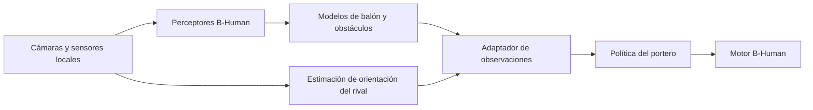

# Visión para el portero: reutilización de B-Human

2026-10-10. **Propuesta de diseño; todavía no es una integración ejecutable.**
Continúa el portero de [PORTERO_ROBUSTO.md](PORTERO_ROBUSTO.md).

La propuesta es reutilizar la detección y el modelado local de B-Human,
completar las medidas que faltan y adaptar sus salidas a la política del
portero. Detectar un robot permite localizarlo; su orientación corporal
requiere información adicional.

## Qué existe y qué está funcionando

La revisión importada de SabanaHerons2026 es
`2360ab1100ad28f70e190c893f6b095651ff0bbc`. Las conclusiones sobre sus campos
se basan en los originales de `baseline/bhuman`, no en el código más reciente
de B-Human.

- `penalty/vision.py` detecta pelota naranja en RGB y estima distancia y
  ángulo. No incluye seguimiento temporal ni compensación completa del
  movimiento de la cámara.
- `heritage/upstream` contiene los perceptores de pelota Trionda originales;
  sus fuentes no se ejecutan en el adaptador NAOqi actual.
- `baseline/bhuman` incluye las representaciones `BallPercept`, `BallModel`,
  `ObstaclesImagePercept`, `ObstaclesFieldPercept` y `ObstacleModel` como
  dependencias del motor. Tener estas estructuras no activa sus proveedores.
- `native/bhuman_motion` ejecuta movimiento y proveedores sensoriales.
  No ejecuta la percepción de robots ni el estimador visual del balón.
- `penalty/nao.py` obtiene imágenes de una cámara a 10 FPS y usa la FSM
  básica. No entrega observaciones a `RobustKeeperPolicy` ni ejecuta sus
  bloqueos físicos. El paquete de despliegue tampoco incluye la política RL.

La documentación de B-Human describe la detección de robots como producción
de cajas en la imagen. El modelado temporal añade estimaciones a partir de
observaciones incompletas, incluido el movimiento del balón. Son piezas que
se pueden reutilizar, pero hay que integrar sus módulos y dependencias.
[Detección de robots](https://docs.b-human.de/coderelease2023/perception/robot-detection/),
[modelado](https://docs.b-human.de/coderelease2023/modeling/overview/).

## Qué necesita el portero y de dónde obtenerlo

| Información | Fuente que se propone reutilizar | Trabajo pendiente |
| --- | --- | --- |
| Posición del balón | `BallPercept.positionOnField` y `BallModel.estimate.position` | Integrar el detector naranja, proyectar al suelo y calibrar |
| Velocidad del balón | `BallModel.estimate.velocity` | Activar el estimador y sus dependencias; validar con cámara y odometría |
| Balón visible y antigüedad | Estado del percepto, tiempo de captura y `timeWhenLastSeen` | Distinguir una detección nueva de una predicción mantenida |
| Posición del tirador | `ObstaclesFieldPercept.center` y `ObstacleModel.obstacles` | Integrar la detección, seleccionar al tirador y mantener su seguimiento |
| Orientación corporal del tirador | No hay campo yaw en las representaciones de obstáculos importadas | Estimar desde su imagen y registrar validez, edad y confianza |
| Inclinación y gyro propios | Sensores y `InertialData` | Lectura sincronizada y conversión al contrato táctico |
| Referencia del arco | Colocación inicial medida o localización visual validada | Calibrar la relación entre portero y línea de gol |
| START, ABORT y reloj | Botones y reloj local | Mantener el límite de 28 s y las mismas condiciones de parada |

`BallModel` contiene posición, velocidad, covarianza y tiempo de última
observación. Una estimación puede mantenerse aunque el balón ya no esté
visible. `ObstaclesFieldPercept` aporta centro, bordes, caída, tipo y
covarianza; `ObstacleModel` añade seguimiento con `lastSeen` y velocidad.

En esas estructuras no aparece la orientación del rival. `RobotPose` es la
pose propia del portero. La dirección de desplazamiento de un obstáculo
tampoco determina hacia dónde orienta el cuerpo: un NAO puede caminar de
lado. La estimación de orientación deberá distinguir frente/espalda y
medirse contra etiquetas del cuerpo, no solo de la cabeza.

## Flujo propuesto

El módulo de visión solo entrega estimaciones. El motor conserva el control
de los movimientos. La propuesta mantiene procesamiento local, sin mensajes
del rival, comunicación de equipo, GameController ni SimRobot.

Si la percepción ya está funcionando dentro de B-Human en el NAO, el adaptador
puede leer directamente sus representaciones. En el runtime separado de
PenaltyStack hay que incorporar los perceptores, estimadores, configuraciones
y pesos necesarios, con revisión y hashes fijados. No son variables que el
ejecutable actual esté calculando. Las adaptaciones y archivos nuevos se
mantendrán fuera de los originales inmutables de `baseline/bhuman`.

## Adaptador y datos desconocidos

Las salidas deben usar el marco del portero: x hacia delante, y hacia su
izquierda, metros y radianes. B-Human publica posición del balón y obstáculos
en mm y velocidad del balón en mm/s; esas magnitudes se multiplican por
0.001. Los tiempos se convierten al mismo reloj local y se conserva el tiempo
de captura, separado del de recepción y decisión.

Se propone un paquete nuevo, `vision_state_v1`, con estimaciones, covarianzas,
tiempos y estados de validez separados para balón, velocidad, posición del
rival y orientación del rival. Estos nombres son de diseño: no hay todavía
una clase ni un protocolo implementados con ellos.

La observación publicada `rl_obs_v1` solo tiene máscara de visibilidad para
el balón; no permite expresar que `opponent_yaw` se desconoce. Para consumir
las nuevas máscaras se propone `rl_obs_v2` y una versión nueva de la política.
La versión existente, sus resultados y contratos permanecen preservados.

Cuando la orientación sea desconocida, la política nueva omitirá la pista
de postura y decidirá por el balón. Así se puede medir por separado cuánto
aporta la postura, sin convertir un yaw arbitrario en una medida. Ante
velocidad no estimable o balón desactualizado, esperará nuevas observaciones
antes de comprometer el salto.

## Integración que aún falta

1. **Proyección y calibración.** Sincronizar imágenes con cabeza, torso y
   articulaciones; comprobar intrínsecos, extrínsecos y tamaño del balón.
   La cámara superior e inferior se procesan con sus propios tiempos;
   seleccionar y fusionar las medidas según cobertura y calidad.
2. **Seguimiento del balón.** Aprovechar el estimador B-Human una vez
   integradas sus entradas. Si se empieza con el detector RGB actual,
   construir un seguimiento equivalente con filtro y odometría. El giro de
   la cabeza o del portero no debe interpretarse como movimiento del balón.
3. **Selección del tirador.** Asociar detecciones entre imágenes y elegir al
   robot próximo al balón con continuidad temporal. Usar tipo/camiseta como
   evidencia cuando sea fiable; los centros y bordes no son una identidad
   estable. Registrar pérdidas de seguimiento y cambios de candidato.
4. **Orientación opcional.** Usar el recorte original del robot como entrada
   de un estimador corporal y validarlo con imágenes del NAO. Mantener esta
   pista deshabilitada hasta medir su calidad; la caja por sí sola no la
   proporciona.
5. **Conexión al motor real.** Integrar la política y el ejecutor de bloqueos
   en el NAO. Esta tarea es separada de la percepción y requiere calibración
   y ensayos incrementales. Un único controlador será dueño de los actuadores.

La proyección de B-Human ya usa matrices de cámara y torso, articulaciones y
calibración propia de cada robot; pequeñas desviaciones afectan la medida
de objetos lejanos. Reutilizar esa infraestructura reduce el trabajo de
geometría, pero exige alimentarla con sensores y calibraciones reales.
[Infraestructura de percepción](https://docs.b-human.de/coderelease2023/perception/perception-infrastructure/).

Para nuestra escena, el balón tiene 65 mm de diámetro y 32.5 mm de radio.
El radio de hardware se medirá y configurará explícitamente fuera del
baseline. También hay que comprobar las suposiciones de cancha, líneas y
camisetas de los detectores: nuestra escena tiene líneas negras y postes
azules. Su disponibilidad en B-Human no demuestra precisión en esta pista.

## Primera etapa y criterios de validación

La primera entrega propuesta es seguimiento del balón y adaptador con
tiempos, unidades y validez, sin depender de la orientación del tirador.
La detección y orientación del rival se incorporan después. Sigue pendiente
medir la política nueva sin la pista de postura: el 84.6 % de `robust` no
demuestra el rendimiento de esa variante.

Antes de movimientos físicos se reproducirán imágenes y sensores grabados.
Se medirán error de posición y velocidad, pérdida visual, identidad del
tirador, error angular y retraso desde captura hasta decisión. Se verificarán
también fotogramas duplicados, salto de reloj, giros de cabeza, oclusión y
transferencia entre cámaras. Cada traza identificará origen real, cámara
simulada o estado de escena privilegiado.

La política nueva se comparará con el base en los ocho estilos, usando
semillas nuevas para selección y evaluación y las mismas condiciones para
ambos porteros. Una prueba con imágenes de MuJoCo se etiquetará como cámara
simulada; los resultados previos basados en poses de escena se conservarán
como una referencia distinta. La prueba final en hardware sigue pendiente.

## Referencias del código revisado

- [BallModel](../baseline/bhuman/Src/Representations/Modeling/BallModel.h) y
  [BallPercept](../baseline/bhuman/Src/Representations/Perception/BallPercepts/BallPercept.h).
- [ObstaclesFieldPercept](../baseline/bhuman/Src/Representations/Perception/ObstaclesPercepts/ObstaclesFieldPercept.h) y
  [Obstacle](../baseline/bhuman/Src/Tools/Modeling/Obstacle.h).
- [CameraMatrix](../baseline/bhuman/Src/Representations/Perception/ImagePreprocessing/CameraMatrix.h),
  [RobotPose](../baseline/bhuman/Src/Representations/Modeling/RobotPose.h) e
  [InertialData](../baseline/bhuman/Src/Representations/Sensing/InertialData.h).
- [Detector RGB](../penalty/vision.py), [adaptador NAOqi](../penalty/nao.py) y
  [paquete de despliegue](../deploy/package.py).
- [Contrato táctico](../penalty/rl/contracts.py),
  [predictor de postura](../penalty/rl/anticipation.py) y
  [política robusta](../penalty/rl/robust_keeper.py).
- [Alcance del runtime actual](../native/bhuman_motion/README.md).
