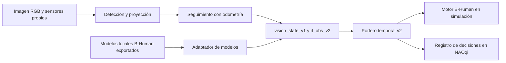

# Visión integrada al portero

2026-10-10. **Primera etapa implementada y probada con cámara de MuJoCo.**
El nuevo portero `vision` obtiene el balón de imágenes RGB, estima su velocidad
y decide cuándo bloquear. En NAOqi existe el mismo recorrido en modo de
observación: registra la decisión, sin ejecutar movimientos físicos.

El detector del rival B-Human ya se ejecuta en un proceso local separado:
red superior y contraste inferior, con proyección/asociación desde píxeles.
Detalle, ensayos y límites en [VISION_BHUMAN_RIVAL.md](VISION_BHUMAN_RIVAL.md).
El v2 de este documento decide por la trayectoria del balón. La nueva ruta
de simulación `keeper_sensor_camera_v2` estima orientación visual y alimenta
el v3 con sensores propios; ver [ORIENTACION_PORTERO.md](ORIENTACION_PORTERO.md).

## Qué se integró

| Componente | Implementación | Estado |
| --- | --- | --- |
| Detección RGB | `orange_candidate` en `penalty/perception.py` | Centro y caja del balón; rechaza candidatos recortados o incompatibles con su tamaño |
| Proyección | `CameraCalibration.project_ball` | Intrínsecos explícitos, transformación cámara → suelo y radio del balón |
| Seguimiento | `BallTracker` | Velocidad entre capturas, compensación con odometría, edad y covarianzas |
| Modelos B-Human | `BHumanVisionAdapter` | Conversión de unidades, tiempos, posición/velocidad y selección del tirador desde snapshots |
| Rival desde píxeles | `robot_detector.py`, `opponent_perception.py`, `native/bhuman_vision/` | Detector B-Human activo en PC; cámaras superior/inferior, posición con validez y orientación desconocida |
| Información desconocida | `vision_state_v1` y `rl_obs_v2` | Máscaras separadas para posición/velocidad del balón y posición/yaw del rival |
| Decisión | `vision_keeper_v2` | Confirma dos capturas, comprueba incertidumbre y estima cruce/llegada |
| Simulación | `CameraDuelWorld` y `SimulatedKeeperCamera` | Cámara en la cabeza; cabeza guiada por detecciones; bloques originales B-Human |
| NAOqi | `penalty/nao_vision.py` | Cámara y sensores locales, START/ABORT, 28 s, registro JSONL; solo observación |
| Reproducción | `tools/replay_keeper_vision.py` | Repite decisiones desde trazas sin robot ni movimientos |

Los contratos y las políticas publicadas v1 permanecen disponibles. La
política `robust` anterior sigue consumiendo `rl_obs_v1`; `vision` exige
`rl_obs_v2`. Pasarle una observación v1 produce un error de contrato, para
evitar que una orientación ficticia se trate como una medida.



## Resultado con cámara simulada

Se reservaron las semillas `65001000000` a `65001000009`, distintas de los
ensayos de desarrollo. Se ejecutaron 10 tiros por estilo y portero: **160
episodios**, con los mismos ocho estilos y semillas para ambos.

| Estilo | Portero `vision` | Base `scripted` |
| --- | ---: | ---: |
| Centro — tirador base del proyecto | 9/10 | 9/10 |
| Mixto | 8/10 | 7/10 |
| Esquinas | 10/10 | 4/10 |
| Suave | 9/10 | 6/10 |
| Disparo demorado | 9/10 | 6/10 |
| Cambio de objetivo | 9/10 | 5/10 |
| Tirador entrenado v1 | 10/10 | 4/10 |
| Tirador entrenado v2 | 10/10 | 3/10 |
| **Total** | **74/80 (92.5 %)** | **44/80 (55 %)** |

Ganancia media: 37.5 puntos porcentuales, IC95 pareado 25–50. Hubo cero
errores de simulación y cero compromisos marcados tempranos. Los fallos
permanecen en el denominador. Es un **ensayo preliminar**, con solo 10 tiros
por estilo; no reemplaza el estudio anterior de 800 tiros por portero.

El error mediano de posición fue 1.19 cm; percentil 95, 1.52 cm. El error
mediano de velocidad fue 0.016 m/s; percentil 95, 0.049 m/s. Son medidas bajo
intrínsecos nominales y extrínsecos/odometría ideales del simulador, tomadas
antes de comprometer el bloqueo. No incluyen todo el recorrido posterior,
retardo real de procesamiento, distorsión o error de sensores de hardware.

Ambos porteros reciben la misma detección y seguimiento desde píxeles. El
base conserva sus reglas de dirección/distancia, con la misma condición de
balón fresco y velocidad medida. El tirador sigue usando las observaciones
de escena con ruido v1. La verdad de escena se consulta únicamente para
evaluar errores y resultados, y nunca para la decisión/cabeza del portero.
Se siguen ejecutando los movimientos originales de B-Human; `scripted`
es la FSM del proyecto, no toda la conducta upstream de B-Human.

El 92.5 % de esta muestra y el 84.6 % anterior corresponden a observaciones
y semillas distintas. No prueban que esta versión supere a `robust` en las
mismas condiciones ni que alcance ese rendimiento en un NAO real.

Reporte: [camera_heldout.json](validation/rl/vision_20261010/camera_heldout.json).
Imagen de la cámara inferior: [camara_mujoco.png](validation/rl/vision_20261010/camara_mujoco.png).
Trazas y procedencia: [vision_20261010](validation/rl/vision_20261010/).

## Tiempos, geometría e información desconocida

Las posiciones se expresan en el marco del portero, x hacia delante e y
hacia la izquierda, en metros; los ángulos, en radianes. La velocidad se
estima en el marco de odometría y después se gira al marco actual del robot:
girar la cabeza o mover el portero no equivale a mover el balón.

`vision_state_v1` conserva origen, captura, recepción, decisión, última
detección, covarianzas, calibración y máscaras. Las fuentes permitidas son
`naoqi_camera`, `simulated_camera`, `bhuman_models` y `scene_privileged`.
Las capturas repetidas/fuera de orden no confirman un tiro. Un salto de
posición, una pérdida larga o un fotograma atrasado impiden usar su derivada.
La posición puede adelantarse al instante de decisión únicamente mientras
la medida/velocidad conservan validez. El portero espera ante velocidad
desconocida, balón no visible o edad mayor de 250 ms.

La proyección RGB supone un balón apoyado en un suelo plano, con su centro
a la altura del radio y transformaciones de cámara medidas. No es un
estimador de vuelos del balón. La covarianza de esta primera etapa deriva
del error en píxeles; no modela todavía toda la incertidumbre de calibración
y odometría del NAO real.

En NAOqi se convierten los timestamps de imagen al reloj monotónico local.
Los sensores se leen al recibir la imagen; una diferencia superior a 80 ms
invalida la medida. La traza identifica esta sincronización como una
aproximación por recepción. Hace falta validar/interpolar sensores a captura
en hardware, además de medir retraso, rolling shutter y giros de cabeza.

## Entrada de modelos B-Human

La revisión importada es SabanaHerons2026
`2360ab1100ad28f70e190c893f6b095651ff0bbc`. Sus 559 originales conservan los
hashes de `baseline/motion_manifest.json`. El host motriz conserva su alcance;
el nuevo host de imágenes `native/bhuman_vision/` ejecuta el detector del
rival con originales importados aparte y pesos de esa misma revisión.

`BHumanVisionAdapter.process` consume un snapshot explícito
`bhuman_local_models_v1`. El productor debe exportar los modelos **locales**,
sus tiempos convertidos al mismo reloj y la validez de la cámara/modelo.
Ejemplo de esquema — los valores siguientes son ilustrativos:

```json
{
  "version": "bhuman_local_models_v1",
  "source": "bhuman_models",
  "capture_s": 100.0,
  "received_s": 100.02,
  "decision_s": 100.03,
  "time_s": 2.0,
  "odometry": [0.0, 0.0, 0.0],
  "ball_model": {
    "position_mm": [1000.0, 100.0],
    "velocity_mm_s": [-500.0, 50.0],
    "covariance_mm2": [[100.0, 0.0], [0.0, 100.0]],
    "velocity_covariance_mm2_s2": null,
    "last_seen_s": 100.0,
    "valid": true,
    "velocity_valid": true,
    "seen_this_frame": true
  },
  "obstacles": [{
    "center_mm": [1200.0, 100.0],
    "covariance_mm2": [[100.0, 0.0], [0.0, 100.0]],
    "last_seen_s": 100.0,
    "type": "opponent",
    "fallen": false
  }]
}
```

`BallModel.estimate.covariance` describe posición, no velocidad. La interfaz
admite una covarianza de velocidad medida por el proveedor/integración; si
falta (`null`), marca la velocidad como desconocida y espera. No se convierte
la covarianza de posición en una certeza inventada de velocidad. El
seguimiento RGB calcula ambas desde sus medidas. Las posiciones/velocidades
del balón se multiplican por 0.001 y las covarianzas por 0.000001.

La selección del tirador usa cercanía al balón, continuidad con odometría,
edad y tipo; descarta compañeros y robots caídos. El identificador de track
lo asigna el adaptador y no equivale a una identidad oficial del obstáculo.
No estima yaw: ni `ObstaclesFieldPercept` ni `ObstacleModel` lo proporcionan.
`RobotPose` es la pose propia; la velocidad de un rival tampoco dice hacia
dónde orienta el cuerpo.

Los proveedores completos de BallModel/ObstacleModel y su exportación siguen
pendientes. El ensayo de 74/80 publicado arriba usa nuestro detector naranja.
La entrega posterior activa el detector B-Human del rival directamente desde
imágenes en un componente aislado; sus resultados propios están en
[VISION_BHUMAN_RIVAL.md](VISION_BHUMAN_RIVAL.md).

## Uso y despliegue

```powershell
# Comparación desde píxeles; 160 episodios, ambas políticas y ocho estilos
.\.venv\Scripts\python.exe tools/evaluate_keeper_vision.py --episodes 10 --workers 4 --seed 65001 --output runs/keeper_vision/camera.json

# Reproducir una traza de decisiones; también acepta snapshots B-Human
.\.venv\Scripts\python.exe tools/replay_keeper_vision.py --input docs/validation/rl/vision_20261010/trace_example.jsonl --output runs/keeper_vision/replay.jsonl

# Pruebas de geometría, reloj, seguimiento, máscaras y cámara real renderizada
.\.venv\Scripts\python.exe -m unittest tests.test_keeper_vision -v
```

El perfil nuevo [keeper.vision.example.json](../profiles/keeper.vision.example.json)
requiere completar serial, intrínsecos medidos, identificador de calibración,
radio del balón y distancia propia a la línea de gol. Los focales cero y
marcadores `TO_FILL` provocan rechazo; no son una calibración por defecto.
El paquete incluye todos los módulos portables nuevos. Los archivos con
texto no ASCII tienen declaración UTF-8 para Python 2.7.

En el NAO se usa el lanzador habitual y `keeper_policy=vision`; el programa
espera START físico, registra observaciones/decisiones y termina con ABORT
o al cumplir 28 s. **`executed=false` en todas las decisiones**. El perfil
rechaza habilitar marcha, patada o bloqueos en este modo. El ejecutor físico
B-Human y la percepción deben compartir un único dueño de actuadores antes
de habilitar un penal completo.

Suite completa: 147 pruebas pasaron en 66.2 s. Tras finalizar la adaptación
de modelos/reproducción y cierre, pasaron 33 pruebas focalizadas. Se verificó la
gramática compatible con Python 2 de los siete módulos del paquete, sus
codificaciones y los hashes originales. No se ejecutó Python 2/NAOqi sobre
un robot real.

## Lo que falta validar

1. Imágenes y sensores grabados del NAO concreto: intrínsecos/extrínsecos,
   tamaño del balón, error de posición/velocidad, oclusión y retraso real.
2. Perceptores/modelos B-Human activos y su exportación local, detección del
   tirador y calidad de asociación; orientación corporal como mejora posterior.
3. Coordinación entre cámaras superior/inferior: esta etapa usa una cámara
   por recorrido, sin fusión entre ellas.
4. Ejecutor de bloqueos y ensayos incrementales de seguridad/calibración,
   seguidos de una comparación física contra el mismo portero base.

Fuentes: [BallModel](../baseline/bhuman/Src/Representations/Modeling/BallModel.h),
[Obstacle](../baseline/bhuman/Src/Tools/Modeling/Obstacle.h),
[CameraMatrix](../baseline/bhuman/Src/Representations/Perception/ImagePreprocessing/CameraMatrix.h).
La infraestructura original transforma cámara/suelo usando torso, cabeza
y calibración del robot: [documentación B-Human](https://docs.b-human.de/coderelease2023/perception/perception-infrastructure/).
La lectura NAOqi de matrices y odometría se basa en la documentación 2.8:
[getTransform](https://docs.nextinsight.eu/doc.aldebaran.com/2-8/naoqi/motion/control-cartesian-api.html)
y [getRobotPosition](https://docs.nextinsight.eu/doc.aldebaran.com/2-8/naoqi/motion/control-walk-api.html).
