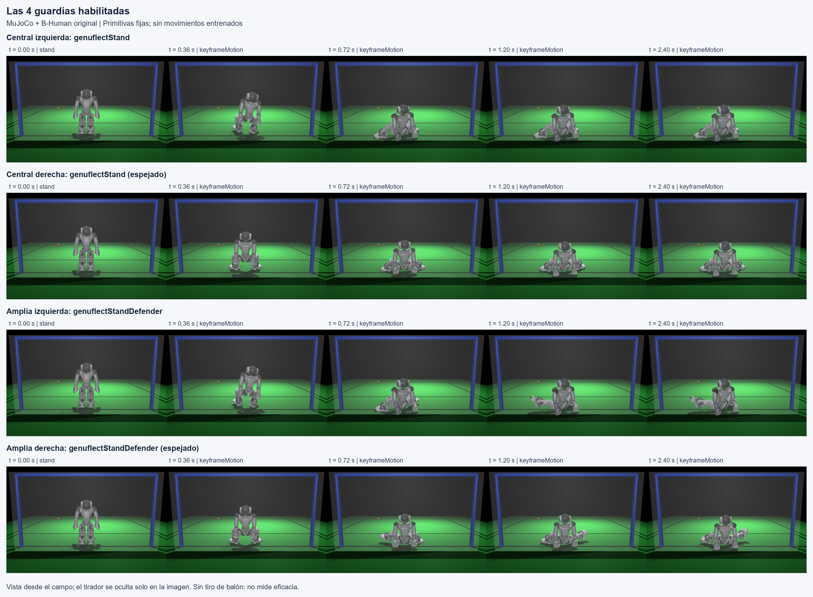
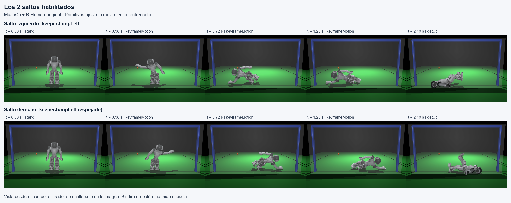
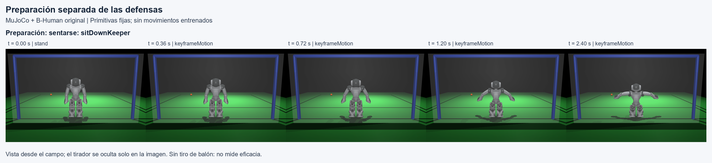

# Defensas originales B-Human: integración de la biblioteca v6

Esta entrega habilita seis defensas y una preparación. Conserva la predicción y la activación de `vision_keeper_v2`; `vision_keeper_v6` cambia únicamente la plantilla central seleccionada. Los movimientos originales no se entrenaron ni modificaron. Diseño y comandos en [DEFENSAS_PORTERO.md](../../../DEFENSAS_PORTERO.md).

## Evidencia

| Verificación | Resultado | Archivo |
| --- | --- | --- |
| Suite completa | 221 pruebas, 85.311 s, OK | [tests.log](tests.log) |
| Plantillas físicas y recuperación | 7/7 solicitudes, hijos recogidos | [motions/summary.json](motions/summary.json) |
| Reproducción de acciones/predicción | 87/87 cuadros idénticos; adaptador publicado v2 sin diferencias de lado/activación | [replay.json](replay.json), [traza](watch_balanced/trace.jsonl) |
| Duelo pareado | 80 ejecuciones, cero `sim_error` | [smoke_72001.json](smoke_72001.json) |
| Fuentes/runtime/originales | SHA-256; 559 originales y RSI3 preservados | [provenance.json](provenance.json), [artifacts.json](artifacts.json) |

Los resultados son de MuJoCo. Sensores ideales, perfil de bajo nivel `mujoco-truth-v2` e inferencia que pausa el reloj físico quedan explícitos. El portero recibe RGB y sensores propios; los tiradores conservan observación privilegiada con ruido declarada. No se probó hardware ni su latencia.

## Ensayo pequeño de atajadas

Ocho estilos (`center`, `mixed`, `corners`, `soft`, `late`, `feint`, `v1`, `v2`), dos semillas de episodio (`72001000000`, `72001000001`), cinco variantes: **16 casos pareados y 80 ejecuciones**. Los estilos v1/v2 son nuestros checkpoints de tirador; no representan una evaluación nueva contra un tirador autónomo completo de B-Human. Todos usan su motor físico B-Human.

| Selección del centro | Atajadas / 16 | Errores |
| --- | --- | --- |
| Original | 8 | 0 |
| Espejado | 11 | 0 |
| Ancho izquierdo | 8 | 0 |
| Ancho derecho | 9 | 0 |
| Según signo del cruce (`balanced`) | 11 | 0 |

El espejo gana tres casos frente al original: dos `late` y uno `mixed`. Es una señal para un ensayo mayor. Sólo hay **dos clusters independientes de semilla**: el IC bootstrap conservado en el JSON es inestable y no sirve aquí como prueba de superioridad. No comparar estos porcentajes con los 400 penales de versiones anteriores. En esta muestra no se seleccionó salto derecho; su ejecución se comprobó en la validación física separada.

`balanced` elige cuatro defensas; las anchas se ensayan en modos separados. No existe aún una política adaptativa validada que elija entre las seis.

## Movimiento y recuperación

Las siete solicitudes se prueban desde una postura inicial, semilla 71001, con el balón fuera de la zona de movimiento y sin patada. Se mantiene la solicitud 3 s y se pide recuperación; los saltos conservan su liberación automática. Se exige `stand`, robot erguido, torso >0.28 m y estabilidad de ambos robots durante 0.5 s, seguida de 1 s adicional con apoyo de ambos pies del portero, dentro de 28 s. Estos tiempos incluyen los 3 s de solicitud y no son tiempos de reacción ni promedios de recuperación.

| Solicitud | Postura estable desde la solicitud (s) |
| --- | --- |
| `center` | 6.804 |
| `center_right` | 6.780 |
| `wide_left` | 7.380 |
| `wide_right` | 7.380 |
| `left` | 12.996 |
| `right` | 8.316 |
| `prepare` | 4.572 |

El primer cuadro de las variantes espejadas puede informar el espejo anterior durante 12 ms: el código original actualiza `MotionInfo` antes de finalizar esa selección. Las trazas conservan el transitorio y confirman después el keyframe y espejo correctos. No se escribieron trayectorias de raíz ni velocidades de balón para producir estas acciones. Este ensayo comprueba ejecución y recuperación; no mide cobertura máxima ni probabilidad de atajada.







Se incluyen siete trazas articulares y siete imágenes de recuperación. Los GIF regenerables se conservaron localmente en `runs/keeper_defenses/motions`; no se duplican en este paquete. El resumen original también registra sus hashes para identificar la corrida completa.

## Ejemplo de predicción

En la [traza `balanced` de estilo `mixed`](watch_balanced/episode.json), v2 predice cruce **28.2 cm a la derecha** y llegada en **2.166 s**. Es zona central (±30 cm); se compromete tras confirmar dos capturas entrantes. v6 solicita `center_right` por el signo negativo del cruce. Resultado de ese penal: atajada. Las 87 decisiones se reproducen exactamente y conservan la activación de v2; yaw del rival no interviene.

La predicción extrapola el balón ya en movimiento. No estima la intención antes de la patada ni modela altura, curva o frenado explícito.

## Reproducir

```powershell
.venv/Scripts/python.exe tools/build_motion_runtime.py
.venv/Scripts/python.exe -m unittest discover -s tests -v
.venv/Scripts/python.exe tools/validate_keeper_defenses.py --output runs/keeper_defenses/motions
.venv/Scripts/python.exe tools/evaluate_keeper_defenses.py --episodes 2 --seed 72001 --workers 4 --output runs/keeper_defenses/smoke_72001.json
.venv/Scripts/python.exe tools/watch_keeper_defenses.py --mode balanced --style mixed --seed 72001000001 --output runs/keeper_defenses/watch_balanced
```

El host compilado se identifica por HELLO y SHA-256 en `provenance.json`. Los hashes de fuentes corresponden a los bytes de la copia Windows utilizada, incluidos finales de línea de fuentes existentes; las fuentes Python nuevas y todos los artefactos crudos preservan sus bytes con `.gitattributes`. `artifacts.json` cubre este paquete sin autorreferenciarse.

This product includes software developed by B-Human (http://www.b-human.de).
