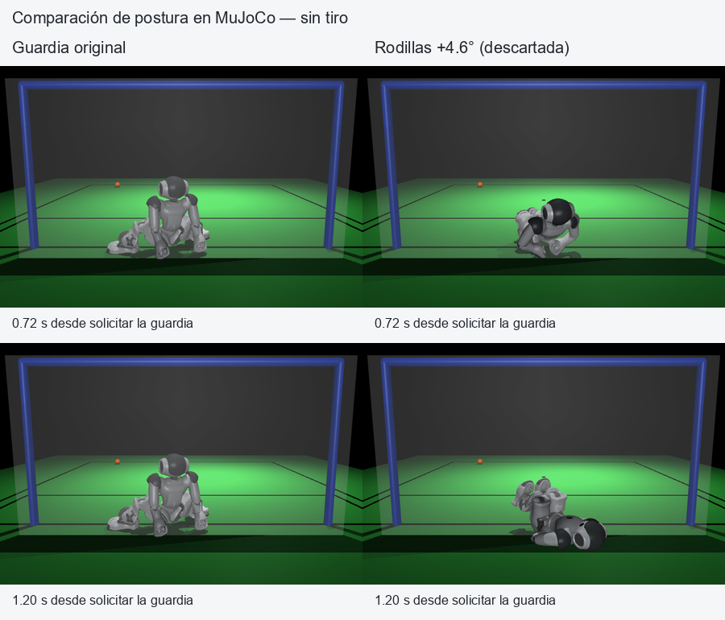

# Ajustes de movimiento B-Human sobre el portero visual v2

Corrida `keeper_motion_training_v1`, 2026-10-11, rama `codex/mejora-portero`.
El perfil elegido obtuvo **136/160 atajadas (85 %)** frente a **134/160
(83.75 %)** del movimiento original con v2 `balanced`. La ganancia de
**1.25 puntos porcentuales** tiene IC95 **−1.875 a +5.0 puntos**: esta muestra
no permite declarar una mejora general. Mantener el perfil experimental y
la configuración predeterminada anterior.

## Qué se entrenó y cómo se eligió

Se optimizaron cuatro parámetros reales acotados de una copia de los keyframes
B-Human: tiempos de guardia y salto, apertura de brazos y flexión de rodillas.
Dieciséis perfiles se fijaron antes de entrenar. El motor original mantiene
interpolación, balance, rigidez, espejado, ramas y recuperación; los originales
de `baseline/bhuman` y RSI3 conservan sus bytes. No se entrena PPO libre de
articulaciones ni se continúa el antiguo checkpoint táctico `keeper_v2`.

El núcleo visual v2 y el selector `balanced` se mantienen iguales. Cada par
comparte reset, contexto del balón desde RGB/sensores propios, predicción,
defensa y tiempo de compromiso. El experimento cambia el movimiento después
de activar la defensa. La orientación del rival no interviene.

| Etapa | Casos independientes | Perfiles | Duelos físicos totales | Atajadas originales | Atajadas del elegido |
|---|---:|---:|---:|---:|---:|
| Entrenamiento | 32 | 16 | 512 en total | 29/32 | 27/32 |
| Validación | 64 | 3 | 192 en total | 54/64 | 56/64 |
| Prueba reservada | 160 | 2 | 320 en total | 134/160 | 136/160 |

Total: **1.024 duelos sobre 256 casos distintos**, además de las comprobaciones
de postura/integración. No son 1.024 tiros independientes. El nominal lideró
el entrenamiento; la regla fijada llevó a validación los dos mejores perfiles
no nominales más el nominal. Allí ganó `candidate_02`, frente a `candidate_01`
(52/64) y nominal (54/64). El modelo se congeló antes de ejecutar la prueba.

Semillas: bases 81001/82001/83001; índices 0–3/0–7/0–19 por estilo,
semilla `base*1000000 + indice_estilo*10000 + episodio`. Las tres particiones
son disjuntas. La prueba no reajustó el modelo. Las fechas y hashes son
procedencia local; no constituyen sellos de tiempo externos.

## Movimiento elegido

Modelo: [`keeper_motion_v1.json`](../../../../models/vision/keeper_motion_v1.json),
`keeper_motion_profile_model_v1`, candidato `candidate_02`.

```json
{"guard_time_scale": 1.0, "jump_time_scale": 0.85,
 "arm_spread_rad": 0.0, "guard_knee_offset_rad": 0.0}
```

La ruta activa del salto usa `sitKeeperJump` (130→110.5 ms) y el alcance de
`jumpLeftFromSitting` (400→340 ms). El bloque `jumpLeftFromStand` también
recibe 130→110.5 ms en la biblioteca, pero no está referenciado por la ruta
actual. No son tres fases consecutivas ejecutadas. Los ángulos finales no
cambian y no hay clamps nuevos; guardias centrales/anchas, `prepare`, caída,
relajación, marcas de fase de 1 ms y recuperación conservan sus valores.

Acortar esas fases un 15 % no significa reducir la latencia perceptiva o todo
el salto un 15 %. En la comprobación manual de una postura, la velocidad
articular máxima medida subió de 17.05 a 19.55 rad/s. No se verificaron límites
de torque/corriente ni calibración física del NAO.

SHA-256 del modelo congelado:
`e797f90d7b9889406a6e0aa08a2ff83925a9c84c55905d285cc90b353974cb7e`.

## Prueba reservada por estilo

| Estilo | Original | Ajustado | Diferencia de atajadas |
|---|---:|---:|---:|
| Centro | 17/20 | 17/20 | 0 |
| Mixto | 18/20 | 18/20 | 0 |
| Esquinas | 18/20 | 19/20 | +1 |
| Suave | 17/20 | 17/20 | 0 |
| Tardío | 19/20 | 20/20 | +1 |
| Amague | 14/20 | 15/20 | +1 |
| Nuestro tirador v1 | 15/20 | 15/20 | 0 |
| Nuestro tirador v2 | 16/20 | 15/20 | −1 |
| **Total** | **134/160** | **136/160** | **+2** |

Hay cinco ganancias y tres pérdidas pareadas; el total de algunos estilos
oculta intercambios de casos. El peor estilo pasa de 70 a 75 %, pero son sólo
20 casos por estilo. El IC usa 10.000 remuestreos pareados independientes
dentro de cada estilo, con igual peso entre estilos. No hay superioridad
estadística demostrada, y el resultado contra nuestro v2 empeora.

Ambos perfiles tienen 12 casos sin compromiso, cero compromisos tempranos y
cero errores de simulación. Los 160 casos permanecen en el denominador:
ajustado 136 atajadas/20 goles/3 fallos del tirador/1 timeout; original
134/22/3/1. `save` conserva la definición publicada del duelo: bloqueo o
desvío con contacto según su horizonte de resultado (hasta 10 s tras el
compromiso); un tiro fallado sin contacto no cuenta como atajada. La
recuperación posterior al tiro no se mide con esa etiqueta.

Selecciones idénticas: `center` 40, `center_right` 30, `left` 53, `right` 25,
`wide_left` 0, `wide_right` 0, sin compromiso 12. Las seis defensas están
habilitadas y comprobadas, pero esta búsqueda de un perfil compartido sobre
`balanced` utilizó cuatro y no demuestra mejora de las anchas.

## Comprobaciones y perfil descartado

Las **96/96** comprobaciones (16 perfiles × seis defensas, sin tiro) completan
ejecución y recuperación estable con apoyo de ambos pies dentro de 28 s;
6.768–22.356 s en la postura inicial ensayada. La auditoría comprueba 74.291
cuadros y 3.072 metadatos de targets. Pasar recuperación no implica bloquear
bien ni valida todas las posturas iniciales.

Añadir 0.08 rad (4.6°) a las rodillas perjudicó la guardia: en entrenamiento
obtuvo 20/32 atajadas frente a 29/32 del nominal. Dos ensayos adicionales sin
tiro, mismo seed 80002004 y estado inicial exactamente igual, muestran la
pérdida de postura. Es una explicación física del perfil descartado, no una
comparación de atajadas del modelo final.



El perfil nominal reproduce exactamente el camino legacy en **1.430 cuadros**
de `center`/`right`: órdenes, rigidez, articulaciones medidas, velocidades,
IMU, FSR y torso. Suite completa: **305 pruebas pasan en 146.702 s**.

En un episodio adicional fuera de la prueba (esquinas, seed 84001000000),
el modelo congelado solicita `right` a 4.404 s y ataja. El host confirma el
perfil real; 45 cuadros reproducen exactamente acciones/decisiones de
v2 `balanced`. Este ejemplo verifica integración, no aumenta la muestra final.

## Evidencia y reproducción

- [Manifiesto](run_manifest.json), [96 comprobaciones](safety_report.json) y
  [trazas comprimidas](safety_traces/).
- [Entrenamiento](train_report.json), [validación](validation_report.json),
  [congelación](fit_report.json) y [prueba reservada](test_report.json).
- [Auditoría de método](method_audit.json), [auditoría final](final_audit.json),
  [revisión nativa](runtime_final_audit.json), [paridad legacy](legacy_parity.json).
- [Observaciones de postura](training_observations.json): snapshot parcial de
  22/32 casos de entrenamiento; los resultados completos están en `train_report`.
- [Episodio adicional](watch_corners/episode.json), traza `.jsonl.gz`,
  [comparación sin tiro](posture_comparison/comparison.json) y generador de figura.
- [Logs](logs/) de compilación, pruebas y corrida; [hashes del paquete](artifacts.json).

Los JSON congelados se copian byte a byte; las trazas de safety conservan sus
hashes originales. Las otras trazas se comprimen sin cambiar los bytes del
JSONL al descomprimir. Las referencias `runs/keeper_motion/...` dentro de
auditorías se corresponden con los subdirectorios aquí archivados.
El modelo y todos los archivos del paquete conservan sus bytes en Git.
Los hashes de fuentes incluyen los terminadores de línea del checkout:
22 archivos de texto existentes usan CRLF en esta corrida y se fijan así
en `.gitattributes`; sus blobs Git siguen en LF y su contenido no cambió.
[Verificación](index_verification.json). Los dos ejecutables nativos se
recompilan y no se incluyen en Git.

```powershell
.venv/Scripts/python.exe tools/build_motion_runtime.py
.venv/Scripts/python.exe tools/train_keeper_motion.py --output runs/keeper_motion/nueva_corrida --model-output models/vision/keeper_motion_nueva.json --workers 6
.venv/Scripts/python.exe tools/watch_keeper_motion.py --model models/vision/keeper_motion_v1.json --style corners --seed 84001000000
.venv/Scripts/python.exe tools/validate_keeper_motion.py --output runs/keeper_motion/posturas --render
```

`--resume` exige la misma configuración, fuentes, modelos y ejecutables; una
recompilación con bytes diferentes requiere una corrida nueva. El visor del
modelo es headless y deja traza; no se probó una GUI de estos ajustes.
Diseño y rangos: [ENTRENAMIENTO_MOVIMIENTO_PORTERO.md](../../../ENTRENAMIENTO_MOVIMIENTO_PORTERO.md).

Todo es MuJoCo con raíces libres, servos y contactos; no se escriben
trayectorias de raíz o velocidades del balón para mover robots. El portero usa
RGB y encoders/IMU/FSR propios simulados; sensores motrices ideales y reloj
físico pausado durante inferencia explícitos. El tirador usa escena
privilegiada con `PerceptionNoise v1`. Nuestros `v1/v2` no son un equipo
B-Human autónomo. **Sin ejecución ni acreditación en un NAO físico.**
